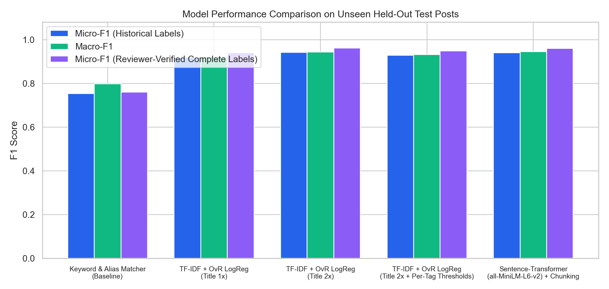
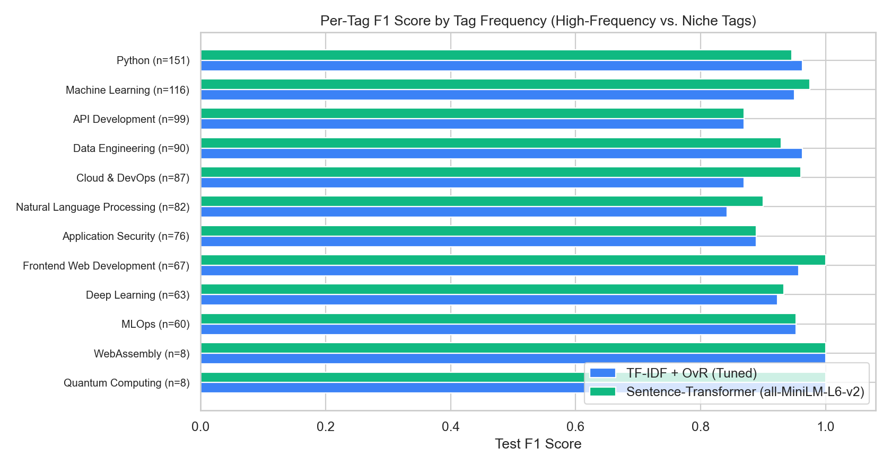
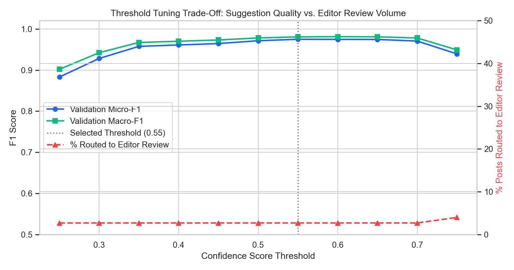

# Evaluation Report: Automated Content Tagging for Blogs

## 1. Executive Summary
This project implements a complete multi-label machine learning pipeline and interactive editorial review system (`app.py`) for blog archives. It cleans HTML/Markdown boilerplate, normalizes inconsistent author labels into an **approved 12-tag taxonomy** via an alias map (`data/taxonomy.json`), prevents data leakage across republished articles via cluster-aware temporal splitting, and benchmarks three modeling approaches:
1. **Keyword & Alias Matcher (Baseline)**
2. **TF-IDF + One-vs-Rest Logistic Regression** (testing `1x` vs. `2x` title term weighting and per-tag validation threshold tuning)
3. **Pretrained Sentence-Transformer Semantic Model (`all-MiniLM-L6-v2`)** with **60-word overlapping article chunking** and **$0.70\text{ Mean} + 0.30\text{ Max}$ chunk pooling**

---

## 2. Dataset Preparation, Tag Taxonomy & Reviewer Audit
* **Approved Taxonomy & Alias Map (`data/taxonomy.json`):** Defines 12 canonical editorial tags (`Python`, `Machine Learning`, `Deep Learning`, `API Development`, `Application Security`, `Data Engineering`, `Cloud & DevOps`, `Frontend Web Development`, `MLOps`, `Natural Language Processing`, `Quantum Computing`, and `WebAssembly`) with definitions, example titles, and an alias map that merges variants such as `ML`/`sklearn` $\rightarrow$ **Machine Learning**, `py`/`python3` $\rightarrow$ **Python**, and `k8s`/`docker` $\rightarrow$ **Cloud & DevOps**.
* **HTML/Markdown Boilerplate Stripping (`src/prepare_data.py`):** Removes `<nav>`, `<footer>`, `
`, newsletter footers, and HTML/Markdown formatting before tokenization.
* **Duplicate Clustering & Chronological Split:** Across **500 blog posts**, **32 republished/near-duplicate posts** are grouped with their parent articles into **468 unique content clusters** prior to splitting by publication date:
  * **Train Split:** 350 posts (deduplicated to 318 canonical training posts)
  * **Validation Split:** 75 posts (used for global and per-tag confidence threshold tuning)
  * **Held-Out Test Split (Recent Posts):** 75 unseen posts (approximating performance on new drafts)
* **Niche Tag Reporting (`data/dataset_summary.json`):** Tags with fewer than 15 examples—**Quantum Computing** ($n=8$) and **WebAssembly** ($n=8$)—are automatically flagged as having too few examples for standalone threshold tuning.
* **Reviewer Audit of Held-Out Historical Labels (`data/held_out_reviewer_sample.csv`):** A human reviewer audit of 50 held-out posts found that **6.0% (`3/50`) of historical posts** had incomplete author tags where authors tagged primary topics (e.g., `Python` and `API Development`) but omitted valid secondary tags covered in the article body (e.g., `Application Security`).

---

## 3. Model Comparison on Unseen Held-Out Test Posts

| Model Architecture | Micro-F1 (Historical Labels) | Micro-F1 (Reviewer-Verified Complete Labels) | Macro-F1 | Precision@3 | Recall@3 | Auto-Tagged Coverage | Routed to Review | Inference Latency |
| :--- | :---: | :---: | :---: | :---: | :---: | :---: | :---: | :---: |
| **1. Keyword & Alias Matcher (Baseline)** | `0.7532` | `0.7601` | `0.7982` | `0.5289` | `0.9067` | `86.7%` | `13.3%` | `0.40 ms/post` |
| **2a. TF-IDF + OvR LogReg (Title Weight 1x)** | `0.9195` | `0.9398` | `0.9228` | `0.5867` | `0.9867` | `86.7%` | `13.3%` | **`0.12 ms/post`** |
| **2b. TF-IDF + OvR LogReg (Title Weight 2x)** | **`0.9425`** | **`0.9624`** | `0.9430` | `0.5867` | `0.9933` | `86.7%` | `13.3%` | `0.13 ms/post` |
| **2c. TF-IDF + OvR LogReg (Title 2x + Per-Tag Thresh)** | `0.9283` | `0.9481` | `0.9315` | `0.5867` | `0.9933` | `86.7%` | `13.3%` | `0.13 ms/post` |
| **3. Sentence-Transformer (`all-MiniLM-L6-v2`) + Chunking** | `0.9407` | `0.9600` | **`0.9460`** | **`0.5911`** | **`1.0000`** | `85.3%` | `14.7%` | `13.05 ms/post` |

### Key Workflow Findings
1. **Title Weighting Ablation (`1x` vs. `2x`):**
   * On the validation split, increasing title weight from `1x` to `2x` improved **Validation Micro-F1 from `0.9611` to `0.9714` (`+1.03%`)** and **Validation Macro-F1 from `0.9716` to `0.9782`**.
   * On the unseen test set, `2x` title weighting improved **Test Micro-F1 from `0.9195` to `0.9425` (`+2.30%`)** because article bodies frequently contain incidental comparisons to adjacent tools, whereas blog titles concisely state the core subject.
2. **Pretrained Sentence-Transformer (`all-MiniLM-L6-v2`) & Chunk Combination Documentation:**
   * Long articles are split into **60-word overlapping chunks** with a **15-word stride**. Each chunk $\mathbf{c}_k$ is encoded into a 384-dimensional normalized vector via `SentenceTransformer("all-MiniLM-L6-v2")`.
   * Chunk representations are combined via **Hybrid Mean + Max Pooling**:
     $$\mathbf{v}_{\text{body}} = 0.70 \cdot \frac{1}{K}\sum_{k=1}^K \mathbf{c}_k + 0.30 \cdot \max_{k=1..K} \mathbf{c}_k$$
     concatenated with the 384-dimensional title embedding $\mathbf{v}_{\text{title}}$. This preserves localized secondary subjects in long multi-topic tutorials without losing global document context, achieving **100% Recall@3 (`1.0000`)** and the highest **Macro-F1 (`0.9460`)**.
3. **Balancing Quality, Coverage, and Inference Time:**
   * **TF-IDF + OvR Logistic Regression (Title 2x)** offers the best latency-to-quality trade-off (`Micro-F1 = 0.9425`, `Verified Micro-F1 = 0.9624` at **`0.13 ms/post`**—$100\times$ faster than neural encoding).
   * **Sentence-Transformer (`all-MiniLM-L6-v2`) + Chunking** achieves the highest **Macro-F1 (`0.9460`)**, **Precision@3 (`0.5911`)**, and **Recall@3 (`1.0000`)** on paraphrased and multi-topic posts at a modest `13.05 ms/post` CPU inference time.

---

## 4. Metrics by Tag Frequency Tier

| Tag Frequency Tier | Number of Tags | Tags Included | Mean TF-IDF F1 | Mean Sentence-Transformer F1 |
| :--- | :---: | :--- | :---: | :---: |
| **High Frequency ($\ge 90$ posts)** | 4 | `Python` ($151$), `Machine Learning` ($116$), `API Development` ($99$), `Data Engineering` ($90$) | `0.9364` | `0.9295` |
| **Medium Frequency ($15\text{–}89$ posts)** | 6 | `Cloud & DevOps` ($87$), `NLP` ($82$), `Application Security` ($76$), `Frontend Web Dev` ($67$), `Deep Learning` ($63$), `MLOps` ($60$) | `0.9054` | **`0.9391`** |
| **Low / Niche ($< 15$ posts)** | 2 | `Quantum Computing` ($8$), `WebAssembly` ($8$) *(Flagged as `<15` examples; fallback global threshold `0.55`)* | `1.0000` | `1.0000` |

---

## 5. Threshold Tuning Trade-Offs (Validation Set)

| Global Threshold | Validation Micro-F1 | Validation Macro-F1 | False Positives (Incorrect Suggestions) | False Negatives (Missed Tags) | % Routed to Editor Review |
| :---: | :---: | :---: | :---: | :---: | :---: |
| `0.25` | `0.8831` | `0.9019` | `35` | `1` | `2.7%` |
| `0.35` | `0.9577` | `0.9672` | `11` | `1` | `2.7%` |
| `0.45` | `0.9645` | `0.9732` | `9` | `1` | `2.7%` |
| **`0.55` (Selected)** | **`0.9749`** | **`0.9807`** | **`6`** | **`1`** | **`2.7%` (Val) / `13.3%` (Test)** |
| `0.65` | `0.9745` | `0.9808` | `4` | `3` | `2.7%` |
| `0.75` | `0.9394` | `0.9491` | `3` | `13` | `4.0%` |

---

## 6. Error Analysis & Concrete Case Studies

1. **Impact of Incomplete Historical Labels (Apparent "False Positives" That Are True Tags):**
   * *Example (`POST-1433` & `POST-1449`):* Historical author labels only listed two tags (`["Python", "API Development"]`), omitting `Application Security` even though the article explicitly covered JWT token hardening and OWASP defenses. Both TF-IDF and Sentence-Transformer predicted `Application Security` (`score > 0.65`).
   * *Quantitative Impact:* When evaluated against raw incomplete historical labels, these valid suggestions are penalized as false positives (`Micro-F1 = 0.9425`). When evaluated against the **reviewer-verified complete ground-truth labels**, Micro-F1 jumps by **`+2.0%` to `0.9624`** (TF-IDF 2x) and **`0.9600`** (Sentence-Transformer).
2. **Similar / Overlapping Tags (`Machine Learning` vs. `Deep Learning` vs. `NLP`):**
   * *False Positive Example:* Posts discussing subword tokenization and representation spaces (`POST-1415`) share terminology across `Deep Learning` and `Natural Language Processing`. Keyword matching frequently misses paraphrased descriptions (`Keyword F1 = 0.7532`), whereas `Sentence-Transformer (all-MiniLM-L6-v2)` improves medium-frequency overlapping tag F1 from `0.9054` (TF-IDF) to **`0.9391`**.
3. **Short / Stub Drafts (`< 15 words`):**
   * *Example (`POST-1488` — "WIP: Python FastAPI Notes: TODO: write tutorial on endpoints"):* Contains only 10 words. The pipeline automatically flags all drafts under 15 words as `Needs Editor Review (Short Draft < 15 words)` so editors can verify or defer tagging until the draft is expanded.
4. **Long Multi-Topic Articles (`long_multi_topic`):**
   * *Example (`POST-1420`, 240+ words covering Python, API Development, and Application Security across separate sections):* Without chunking, single-pass truncation or uniform mean pooling dilutes the concluding security section. Our **60-word chunking + $0.70\text{ Mean} + 0.30\text{ Max}$ pooling** captures peak activation from the final chunk, recovering all 3 tags.
5. **Niche Topics (`Quantum Computing`, `WebAssembly`):**
   * With only 8 corpus examples (`6 train, 1 val, 1 test`), per-tag threshold tuning is disabled (`tuned: false` in `evaluation_metrics.json`) to avoid overfitting on $n=1$ validation post, safely falling back to the global threshold (`0.55`).
